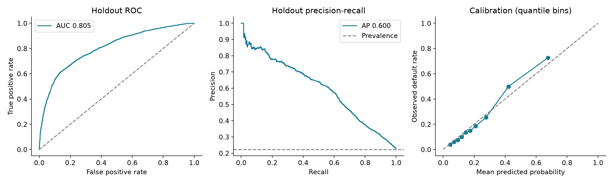

# Credit Risk ML

A reproducible credit-default benchmark with grouped data splits, training-only preprocessing, model comparison, probability calibration, cost-sensitive threshold selection, and batch inference.

**Held-out results:** ROC-AUC **0.805**, average precision **0.600**, Brier score **0.129** on **6,013 records** (22.25% default prevalence). These are offline benchmark results, not production lending outcomes.



## Run

Tested on Python 3.14.7, scikit-learn 1.9.1. From this directory:

```bash
python3.14 -m venv .venv
source .venv/bin/activate
python -m pip install -r requirements.lock.txt
python -m pip install --no-deps -e .
pytest -q
credit-risk train
credit-risk predict --input examples/applicants.csv --output examples/predictions.csv
```

Training downloads the official UCI archive when absent, writes its SHA-256 to `reports/metrics.json`, saves the model to `models/model.joblib`, and generates evaluation plots. Internet access is needed only for dependencies and the initial dataset download. Local model artifacts and raw data are excluded from Git. Examples are invented input records, not copied individuals. Load only trusted joblib artifacts.

## Modeling decisions

- Retain all 30,000 observations. Hash the 19 financial input fields and keep identical feature vectors in the same partition. Train/validation/test sizes are 17,962/6,025/6,013. Group splitting is approximately 60/20/20, not stratified; prevalence is reported for every partition.
- Exclude ID and four demographic variables from prediction. This is a feature policy, not a fairness guarantee. Correlated financial attributes may still encode demographic differences.
- Add six financial-history features: bill-to-limit and payment-to-limit ratios, maximum and mean delay, and average bill/payment ratios.
- Fit feature processing, median imputation, missing indicators and scaling inside each estimator pipeline. No statistics are learned from validation or test data.
- Compare a prior baseline, logistic regression, histogram gradient boosting, and a three-fold sigmoid-calibrated gradient boosting ensemble. Calibration folds also respect duplicate-feature groups.
- Select the model by validation average precision (AP), with Brier score as the tie-breaker. Select the operating threshold on validation data only. Keep the selected fitted model; do not refit on validation data.
- Evaluate the frozen model once on the final holdout. Use 200 group-bootstrap resamples for uncertainty. AP is scikit-learn's non-interpolated average precision, not trapezoidal PR-AUC.

## Validation comparison

| Model | ROC-AUC | AP | Brier (lower is better) |
|---|---:|---:|---:|
| Prior baseline | 0.500 | 0.224 | 0.174 |
| Logistic regression | 0.731 | 0.493 | 0.147 |
| Gradient boosting | 0.779 | 0.549 | 0.136 |
| Calibrated gradient boosting | 0.780 | 0.552 | 0.136 |

Calibration did **not** improve validation Brier score relative to uncalibrated boosting (0.136277 vs 0.136022). The calibrated ensemble won narrowly on the predeclared AP criterion; this experiment does not establish a statistically significant advantage or isolate the effect of calibration from ensembling.

## Frozen holdout result

| Metric | Result |
|---|---:|
| ROC-AUC | 0.8054 |
| ROC-AUC 95% group-bootstrap interval | 0.7912–0.8197 |
| Average precision | 0.6000 |
| AP 95% group-bootstrap interval | 0.5695–0.6278 |
| Brier score | 0.1288 |
| Selected probability threshold | 0.194 |
| Precision / recall | 42.63% / 74.14% |
| Flagged for review | 38.70% |

The threshold minimizes validation `FP + 5 × FN`, an **illustrative assumption**, not observed dollar losses or a Ramp policy. Test confusion matrix: TN=3,340; FP=1,335; FN=346; TP=992. This flags many nondefaulters; it must not be described as a demonstrated business saving or used to make lending decisions.

## Engineering and tests

The package separates acquisition/schema checks, model construction/evaluation, and CLI execution. Eleven local tests cover duplicate-group separation, malformed inputs, column-order invariance, nonmutating feature construction, training-only imputation, model serialization, and threshold/count correctness. The published GitHub Actions workflow passed all 11 tests on Linux; see [the verified run](https://github.com/1143151076-pixel/dulin/actions/runs/42417818253). Validation permutation importance is in `reports/feature_importance.csv` and measures predictive association, not causation.

## Data and limitations

Source: I. Yeh (2009), *Default of Credit Card Clients*, UCI Machine Learning Repository, [DOI 10.24432/C55S3H](https://doi.org/10.24432/C55S3H), [dataset page](https://archive.ics.uci.edu/dataset/350/default+of+credit+card+clients). Data licensed CC BY 4.0. The input is historical Taiwanese consumer credit data with April–September 2005 financial histories; it is not Ramp corporate-card data. Adaptations: selected financial columns, derived ratios/history features, and grouped partitioning.

This is a single-cohort random group holdout, not a forward-time validation. Temporal drift, customer-level longitudinal leakage, selection bias, reject inference, subgroup fairness and deployment monitoring remain untested. Excluding demographics does not resolve these limitations. No production integration, online experiment, real revenue impact or approval decision is claimed.

## Authorship

Created as an AI-assisted personal portfolio project for Du Lin. Implementation, execution and documentation were produced with coding-assistant support. The owner should review the code, reproduce the experiment and explain the design before representing personal proficiency. This is not an employer or university research deliverable and has no affiliation with Ramp.

## Layout

- `src/credit_risk/data.py`: source download, schema, features
- `src/credit_risk/model.py`: partitions, candidates, evaluation
- `src/credit_risk/cli.py`: train and predict commands
- `tests/`: deterministic unit tests; no data download required
- `reports/`: measured results and plot
- `examples/`: synthetic input and generated predictions
- `.github/workflows/tests.yml`: test workflow

References: [scikit-learn AP](https://scikit-learn.org/stable/modules/generated/sklearn.metrics.average_precision_score.html), [probability calibration](https://scikit-learn.org/stable/modules/calibration.html).
